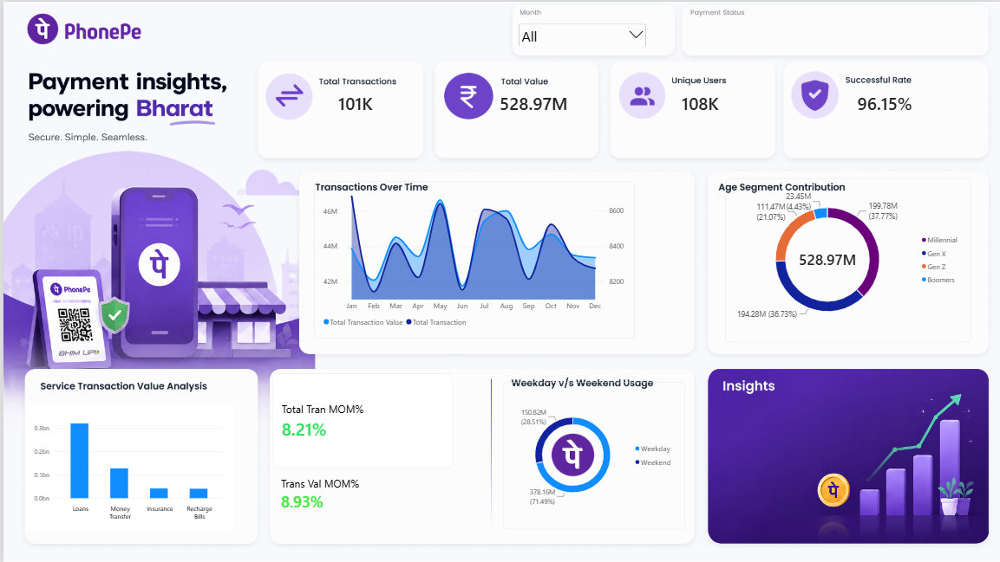

# PhonePe - Payment Insights & Analytics Dashboard 🚀

An end-to-end data analytics project featuring interactive **Power BI** dashboards and **SQL Queries** to analyze transaction patterns, customer demographics, usage behaviors, and service-wise performance for PhonePe.

---

## 📸 Dashboard Preview



---

## 📌 Project Overview

This project provides actionable business insights into digital payment performance across various dimensions including user demographics, service categories, day-of-week trends, and month-over-month growth. Designed with modern UI/UX principles, the dashboard allows business stakeholders and recruiters to easily digest key performance indicators (KPIs) and data stories.

### Key Metrics Tracked:
* **Total Transactions:** 101K
* **Total Transaction Value:** ₹528.97M
* **Unique Users:** 108K
* **Success Rate:** 96.15%
* **MoM Growth:** Total Transactions (+8.21%) | Transaction Value (+8.93%)

---

## 🛠️ Key Learnings & Skills Demonstrated

- **Dashboard Layout & Design:** Applied visual hierarchy, clean card structures, and a consistent PhonePe purple color scheme.
- **KPI Card & Tooltip Design:** Created custom KPI cards and interactive tooltips to summarize key metrics efficiently.
- **Data Modeling & DAX:** Developed DAX measures for Month-over-Month (MoM%) growth tracking and time-intelligence analyses.
- **Service-Wise Transaction Analysis:** Evaluated transaction volume across *Loans, Money Transfer, Insurance, and Recharge & Bills*.
- **Customer & Age Segmentation:** Analyzed revenue and usage contributions across demographics (*Millennial, Gen X, Gen Z, Boomers*).
- **Weekday vs. Weekend Analysis:** Segmented digital transaction distribution to understand peak user activity days.
- **SQL Data Analysis:** Wrote robust SQL queries for data extraction, transformation, aggregation, and validation.
- **Business Storytelling:** Turned raw transactional data into recruiter-ready insights and executive summaries.

---

## 💡 Key Business Insights

1. **Age Segment Breakdown:**
   - **Millennials** contribute the highest volume and value (~37.77% / ₹199.78M), closely followed by **Gen X** (~36.73% / ₹194.28M).
   - **Gen Z** makes up ~21.07% of transactions, representing a major growth opportunity.

2. **Weekday vs. Weekend Usage:**
   - **71.49%** (₹378.16M) of total transaction value occurs on **Weekdays**, showing strong reliance on PhonePe for daily essential commerce and peer-to-peer transfers.
   - **28.51%** (₹150.82M) occurs on **Weekends**.

3. **Service Category Breakdown:**
   - **Loans** and **Money Transfer** dominate transaction value compared to Insurance and Recharge/Bills.

4. **MoM Growth Momentum:**
   - Consistent upward momentum in transaction counts (+8.21%) and total value (+8.93%) reflects strong month-over-month user retention and adoption.

---

## 📁 Repository Structure

```text
├── Dashboard.jpg           # High-resolution screenshot of the Power BI report
├── PhonePe_Dashboard.pbix  # Power BI Desktop report file
├── queries.sql             # SQL queries used for data extraction and analysis
└── README.md               # Documentation
```

---

## 🔍 Key SQL Queries

<details>
<summary>Click to view sample SQL queries</summary>

```sql
-- 1. How many transactions were recorded?
SELECT 
    COUNT(Transaction_ID) AS Total_Transactions
FROM All_Transactions;


-- 2. What is the total transaction value?
SELECT 
    SUM(Amount) AS Total_Transaction_Value
FROM All_Transactions;


-- 3. How many distinct users transacted in the selected period?
SELECT 
    COUNT(DISTINCT User_ID) AS Unique_Users
FROM All_Transactions;


-- 4. What percentage of transactions succeeded?
SELECT 
    ROUND(
        (SUM(CASE WHEN Payment_Status = 'Success' THEN 1 ELSE 0 END) * 100.0) / COUNT(*), 
        2
    ) AS Success_Rate_Percentage
FROM All_Transactions;


-- 5. How are transaction count and value changing over time?
SELECT 
    d.Month,
    d.Month_No,
    COUNT(t.Transaction_ID) AS Total_Transactions,
    SUM(t.Amount) AS Total_Transaction_Value
FROM All_Transactions t
JOIN Date_Table d ON t.Date = d.Date
GROUP BY d.Month, d.Month_No
ORDER BY d.Month_No;


-- 6. Which service categories contribute the most value?
SELECT 
    Service,
    SUM(Amount) AS Total_Value,
    COUNT(Transaction_ID) AS Total_Transactions
FROM All_Transactions
GROUP BY Service
ORDER BY Total_Value DESC;


-- 7. How does activity differ between weekdays and weekends?
SELECT 
    CASE 
        WHEN DATENAME(WEEKDAY, t.Date) IN ('Saturday', 'Sunday') THEN 'Weekend'
        ELSE 'Weekday'
    END AS Day_Type,
    COUNT(t.Transaction_ID) AS Total_Transactions,
    SUM(t.Amount) AS Total_Transaction_Value
FROM All_Transactions t
GROUP BY 
    CASE 
        WHEN DATENAME(WEEKDAY, t.Date) IN ('Saturday', 'Sunday') THEN 'Weekend'
        ELSE 'Weekday'
    END;


-- 8. How did transaction count and value change from the previous month? (MoM%)
WITH Monthly_Summary AS (
    SELECT 
        d.Month_No,
        d.Month,
        COUNT(t.Transaction_ID) AS Current_Month_Transactions,
        SUM(t.Amount) AS Current_Month_Value
    FROM All_Transactions t
    JOIN Date_Table d ON t.Date = d.Date
    GROUP BY d.Month_No, d.Month
)
SELECT 
    Month,
    Current_Month_Transactions,
    LAG(Current_Month_Transactions, 1) OVER (ORDER BY Month_No) AS Previous_Month_Transactions,
    ROUND(
        ((Current_Month_Transactions - LAG(Current_Month_Transactions, 1) OVER (ORDER BY Month_No)) * 100.0) 
        / NULLIF(LAG(Current_Month_Transactions, 1) OVER (ORDER BY Month_No), 0), 2
    ) AS Trans_MoM_Percentage,
    Current_Month_Value,
    LAG(Current_Month_Value, 1) OVER (ORDER BY Month_No) AS Previous_Month_Value,
    ROUND(
        ((Current_Month_Value - LAG(Current_Month_Value, 1) OVER (ORDER BY Month_No)) * 100.0) 
        / NULLIF(LAG(Current_Month_Value, 1) OVER (ORDER BY Month_No), 0), 2
    ) AS Value_MoM_Percentage
FROM Monthly_Summary
ORDER BY Month_No;
```

</details>

---

## 🛠️ Tools & Technologies Used

* **Power BI Desktop** (Data visualization, DAX, Custom Tooltips)
* **SQL** (Data Extraction, Aggregations, Window Functions)
* **Excel / CSV** (Data Cleaning & Preparation)

---
